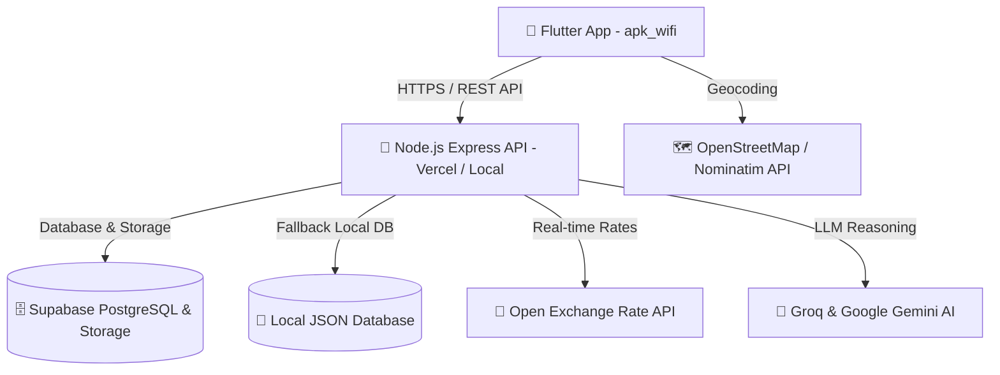

# 🌐 SIMA.NET — Smart ISP Reseller & Fiber Operations App

> **Aplikasi Mobile Terintegrasi Multi-Role & Backend REST API untuk Operasional ISP (Internet Service Provider)**  
> Proyek Ujian Akhir Semester / Tugas Besar Mata Kuliah **Pemrograman Mobile** (Semester 5).

---

## 👥 Tim Pengembang
| Nama | Peran |
|---|---|
| **Dimas Rhito** | Mobile Developer |
| **Andhika Guntur Ramadan** | Fullstack & Mobile Developer |
| **Zaky** | Mobile & UI/UX Developer |

---

## 📌 Ringkasan Proyek

**SIMA.NET** adalah ekosistem aplikasi mobile berbasis **Flutter** dan **Node.js (Express REST API)** yang dirancang untuk mendukung transformasi digital penyedia layanan internet (ISP reseller / RT-RW Net). Sistem ini menyediakan 3 hak akses (Role) berbeda dalam satu aplikasi (*single shell architecture*):

1. **Pelanggan (Customer)**: Melihat status langganan, memilih/mengajukan perubahan paket, konversi mata uang (*live multi-currency exchange rate*) & zona waktu (diaspora), melihat & membayar tagihan via QRIS/transfer, chat bantuan, serta komplain gangguan.
2. **Teknisi Lapangan (Technician)**: Menerima Surat Perintah Kerja (SPK), navigasi ke lokasi pelanggan dengan peta, fitur **Leveling Modem (Sensor Accelerometer)** saat instalasi fisik ONT, dan upload dokumentasi penyelesaian pekerjaan.
3. **Admin Operasional (Admin Hub)**: Monitoring KPI operasional, persetujuan pengajuan ubah paket / pemutusan layanan pelanggan, verifikasi tagihan dan invoice, **Forecasting Pendapatan & Churn menggunakan Linear Regression**, serta konsultasi performa bisnis via **AI Advisor**.

---

## 🏗️ Arsitektur Sistem

Proyek ini dibangun menggunakan struktur **Monorepo**:

```
Project-Mobil/
├── apk_wifi/       # Frontend Mobile Application (Flutter & Dart)
├── backend/        # Backend REST API Server (Node.js, Express, Supabase)
└── README.md       # Dokumentasi Proyek
```



- **Backend Production URL**: [`https://backend-sima.vercel.app`](https://backend-sima.vercel.app)
- **Backend GitHub Repo**: [`https://github.com/andhikaguntur/backend-sima`](https://github.com/andhikaguntur/backend-sima)
- **Database Utama**: Supabase PostgreSQL dengan sinkronisasi otomatis dan fallback *in-memory JSON*.
- **Storage**: Supabase Storage + Backend Image Proxy (`/storage/proxy`) untuk stabilitas emulator.

---

## ✨ Fitur Unggulan

### 1. 📱 Flutter Mobile App (`apk_wifi`)
- **Autentikasi Multi-Role & Keamanan Biometrik**:
  - Login role-based dinamis (Pelanggan, Teknisi, Admin) dengan JWT Token disimpan di `flutter_secure_storage`.
  - Dukungan autentikasi sidik jari / Face ID menggunakan `local_auth`.
  - Registrasi pelanggan baru dengan **GPS Otomatis** & *Reverse Geocoding* alamat via OpenStreetMap (OSM Nominatim).
- **Portal Pelanggan (Customer)**:
  - **Katalog & Pengajuan Ubah Paket**: Menampilkan pilihan paket internet, perbandingan visual modern *side-by-side*, dan pengajuan upgrade/downgrade ke admin.
  - **Live Multi-Currency & Timezone Converter**: Konversi tarif internet real-time (IDR, USD, EUR) dari API kurs internasional serta penyesuaian zona waktu pelanggan diaspora (WIB, London, UTC).
  - **Tagihan & Invoice**: Pembayaran tagihan, unduh/tinjau invoice, dan upload bukti transfer (`image_picker`).
  - **Live Chat Bantuan**: Obrolan interaktif langsung dengan customer service / admin.
- **Portal Teknisi (Technician)**:
  - **Daftar Tugas (SPK)**: Pemasangan baru, perbaikan gangguan, dan penarikan modem pemutusan langganan.
  - **Alat Leveling Modem (Sensor Accelerometer)**: Pemanfaatan sensor gerak perangkat fisik (`sensors_plus`) untuk memastikan pemasangan router/modem tegak lurus dan presisi.
  - **Penyelesaian Tugas**: Catatan teknis, input redaman kabel (dBm), dan bukti foto instalasi.
- **Admin Hub & Intelligence**:
  - **Persetujuan Pengajuan Paket**: Tinjau pengajuan pelanggan (upgrade, downgrade, pemutusan) dengan otomatis menerbitkan SPK ke teknisi.
  - **Analisis & Prediksi (Linear Regression)**: Visualisasi grafik performa pendapatan dan prediksi churn pelanggan menggunakan `fl_chart`.
  - **AI Business Advisor**: Konsultasi strategi bisnis ISP yang ditenagai oleh model AI generatif (Groq / Gemini).
- **Halaman Kesan & Saran Kuliah**:
  - Halaman refleksi perkuliahan Pemrograman Mobile berisi kesan langsung dari anggota tim (Dimas Rhito, Guntur, Zaky) serta saran kurikulum.

---

### 2. 🚀 Backend REST API (`backend`)
- **Node.js & Express Modular**:
  - `/api/auth`: Login, registrasi, validasi token, ganti password, profile update.
  - `/api/customer`: Detail pelanggan, ubah paket, histori invoice, devices, komplain.
  - `/api/task`: Manajemen SPK teknisi (ambil tugas, mulai, selesaikan dengan foto).
  - `/api/invoice`: Manajemen tagihan, pembayaran, verifikasi bukti bayar admin.
  - `/api/chat`: Pesan live chat antar pengguna dan admin.
  - `/api/analytics`: Metrik pendapatan, MRR, pengguna aktif, bandwidth, dan churn rate.
  - `/api/ai-advisor`: Konsultasi AI cerdas rekomendasi strategi ISP berbasis data riil.
  - `/rates`: Live exchange rate caching multi-CDN (USD & EUR terhadap IDR).
  - `/common`: Feedback saran & kesan pengguna serta informasi sistem.
- **Double-Layer Data Resilience**:
  - Menggunakan Supabase Cloud PostgreSQL bila koneksi tersedia.
  - Otomatis beralih ke database lokal (`database.json`) jika offline / tanpa jaringan internet.
- **Storage Image Proxy**:
  - Endpoint `/storage/proxy` mem-proxy aset gambar untuk mencegah kegagalan DNS emulator Android saat memuat URL gambar Supabase.

---

## 🛠️ Tech Stack & Dependencies

### Frontend (Mobile)
- **Framework**: Flutter SDK `^3.13.2` / Dart
- **UI & State**: Material Design 3, Custom Glassmorphism Theme, HSL Colors
- **Libraries**:
  - `http` & `flutter_dotenv`: REST API communication & environment config
  - `flutter_secure_storage`: Penyimpanan aman JWT Token & sesi
  - `local_auth`: Autentikasi biometrik (Fingerprint / Face ID)
  - `flutter_map` & `latlong2`: Peta interaktif OpenStreetMap
  - `geolocator`: Deteksi koordinat GPS perangkat
  - `sensors_plus`: Akses sensor Accelerometer / Gyroscope (modem leveling)
  - `image_picker`: Pengambilan foto kamera / galeri
  - `fl_chart`: Grafik visual analitik & peramalan (forecasting)
  - `flutter_local_notifications`: Notifikasi lokal sistem
  - `intl`: Format tanggal dan mata uang Rupiah/USD

### Backend (Server)
- **Runtime & Engine**: Node.js, Express.js
- **Database**: Supabase PostgreSQL (`@supabase/supabase-js`) & Fallback JSON Database
- **Keamanan & Auth**: JWT (`jsonwebtoken`), Password Hashing (`bcryptjs`), CORS
- **Media Upload**: `multer` untuk upload bukti bayar dan pekerjaan teknisi
- **Kecerdasan Buatan (AI)**: `groq-sdk` & Google Gemini (`@google/genai`)
- **Kurs Real-time**: `fawazahmed0/exchange-api` via multi-CDN (jsDelivr & Cloudflare Pages)

---

## 🚀 Panduan Menjalankan Proyek

### Prasyarat
- [Flutter SDK](https://docs.flutter.dev/get-started/install) (versi 3.13 atau lebih baru)
- [Node.js](https://nodejs.org/) (versi 18 atau lebih baru)
- [Android Studio](https://developer.android.com/studio) atau Perangkat Android fisik dengan USB Debugging aktif.

---

### Langkah 1: Menjalankan Backend

1. Buka terminal dan masuk ke folder `backend`:
   ```bash
   cd backend
   ```
2. Salin file environment:
   ```bash
   cp .env.example .env
   ```
   *(Opsional: Sesuaikan kredensial Supabase / Gemini jika ingin menggunakan database cloud sendiri).*
3. Instal dependencies:
   ```bash
   npm install
   ```
4. Jalankan server backend:
   ```bash
   # Mode Development (auto-reload)
   npm run dev

   # atau Mode Normal
   npm start
   ```
   Server akan aktif di: `http://localhost:3000` (atau IP LAN Anda, misal: `http://192.168.1.10:3000`).

---

### Langkah 2: Menjalankan Aplikasi Flutter

1. Buka terminal baru dan masuk ke direktori `apk_wifi`:
   ```bash
   cd apk_wifi
   ```
2. Unduh seluruh package Flutter:
   ```bash
   flutter pub get
   ```
3. Konfigurasi alamat backend di file `.env` (atau `lib/config/app_config.dart`):
   ```env
   # Gunakan server Vercel (Default):
   BACKEND_BASE_URL=https://backend-sima.vercel.app

   # ATAU jika menjalankan server lokal di HP fisik/emulator:
   # Emulator Android: http://10.0.2.2:3000
   # Device Fisik (IP LAN): http://192.168.x.x:3000
   ```
4. Jalankan aplikasi pada emulator atau perangkat:
   ```bash
   flutter run
   ```

---

## 🔑 Akun Demo Pengujian

Aplikasi telah dilengkapi dengan data *seed* default untuk menguji setiap peran:

| Peran (Role) | Email | Password | Keterangan |
|---|---|---|---|
| **Administrator** | `admin@sima.net` | `123` | Akses Admin Hub, approval paket, verifikasi invoice, AI Advisor, analitik |
| **Pelanggan (Lokal)** | `budi@gmail.com` | `123` | Pelanggan Yogyakarta (Paket 30 Mbps, mata uang IDR) |
| **Pelanggan (Diaspora)** | `sarah@gmail.com` | `123` | Pelanggan US Diaspora (Paket 50 Mbps, mata uang USD) |
| **Teknisi Lapangan** | `teknisi@sima.net` | `123` | Akses daftar tugas SPK lapangan, alat sensor leveling modem |

---

## 📡 Daftar Endpoint REST API Utama

| Method | Endpoint | Deskripsi | Auth |
|---|---|---|---|
| `POST` | `/api/auth/login` | Login user & mendapatkan token JWT | Publik |
| `POST` | `/api/auth/register` | Pendaftaran pelanggan baru dengan GPS | Publik |
| `GET` | `/api/auth/me` | Mengambil profil user yang sedang aktif | Bearer Token |
| `GET` | `/rates` | Mengambil kurs valuta asing live (USD, EUR, IDR) | Publik |
| `GET` | `/api/packages` | Mengambil seluruh katalog paket internet | Publik |
| `POST` | `/api/customer/request-change` | Mengajukan upgrade/downgrade paket ke admin | Pelanggan |
| `GET` | `/api/invoices/my` | Mengambil daftar tagihan & invoice pelanggan | Pelanggan |
| `POST` | `/api/invoices/:id/pay` | Upload bukti pembayaran tagihan | Pelanggan |
| `GET` | `/api/tasks/my` | Mengambil daftar SPK tugas teknisi | Teknisi |
| `POST` | `/api/tasks/:id/complete` | Menyelesaikan tugas teknisi & upload bukti foto | Teknisi |
| `GET` | `/api/admin/package-requests` | Mengambil daftar permohonan ubah paket pending | Admin |
| `POST` | `/api/admin/package-requests/:id/approve` | Menyetujui ubah paket & terbitkan SPK otomatis | Admin |
| `GET` | `/api/analytics/forecast` | Data proyeksi pendapatan & analisis linear regression | Admin |
| `POST` | `/api/ai-advisor/query` | Konsultasi analisis data bisnis dengan AI | Admin |
| `POST` | `/api/common/feedback` | Mengirimkan masukan saran & kesan pengguna | Pelanggan/Semua |
| `GET` | `/storage/proxy` | Proxy image loader untuk aset media eksternal | Publik |

---

## 📁 Struktur Direktori

```
Project-Mobil/
├── apk_wifi/                       # Flutter Mobile Project
│   ├── android/                    # Android Native Config & Permissions
│   ├── assets/                     # Gambar, logo, & font lokal
│   ├── lib/
│   │   ├── config/                 # Konfigurasi aplikasi, tema (AppTheme), baseUrl
│   │   ├── models/                 # Model data Dart (User, Package, Invoice, Task, Feedback)
│   │   ├── screens/
│   │   │   ├── admin/              # Admin Hub, tabs overview, invoice, forecasting
│   │   │   ├── auth/               # Login, registrasi dengan GPS picker
│   │   │   ├── common/             # Shell navigasi, Profil, Kurs Valuta, Kesan & Saran
│   │   │   ├── customer/           # Beranda pelanggan, paket internet, tagihan, chat
│   │   │   └── technician/         # Beranda teknisi, SPK, tool sensor leveling modem
│   │   ├── services/               # API service, sensor handler, biometrik, currency service
│   │   ├── widgets/                # Komponen UI reusable (CustomCard, Buttons, Badges)
│   │   └── main.dart               # Entry point aplikasi Flutter
│   └── pubspec.yaml                # Package dependencies Flutter
│
├── backend/                        # Node.js Express REST API
│   ├── api/                        # Vercel serverless entrypoint
│   ├── config/                     # Konfigurasi environment & Supabase client
│   ├── db/                         # In-memory & fallback JSON database
│   ├── middleware/                 # Middleware autentikasi JWT & Role authorization
│   ├── routes/                     # Router modular (auth, customer, task, invoice, AI, dll)
│   ├── services/                   # Supabase DB service, live exchange rate service
│   ├── utils/                      # Helper linear regression, hash validator, formatting
│   ├── database.json               # Seed database offline
│   ├── package.json                # Dependencies backend
│   ├── server.js                   # Server entrypoint lokal
│   └── vercel.json                 # Konfigurasi deployment Vercel
│
└── README.md                       # Dokumentasi utama proyek
```

---

## 📝 Kesan & Saran Perkuliahan

> *"Mata kuliah Pemrograman Mobile ini memberikan pengalaman berharga dan praktikal dalam membangun aplikasi multi-role modern dengan integrasi API, sensor perangkat keras, hingga implementasi kecerdasan buatan."*  
> — **Dimas Rhito, Guntur, & Zaky** (Semester 5)

---
*Dibuat untuk memenuhi Tugas Besar / Proyek Akhir Mata Kuliah Pemrograman Mobile.*
